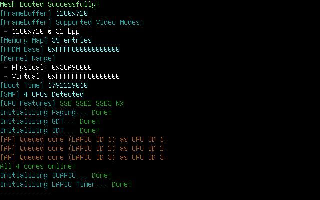

# Mesh

> An x86-64 SMP kernel where every process owns its physical memory. Written in C++ and x86 Assembly.

<p align="center">
  
</p>

### Architecture

#### Bodies

A process is a *body*: a set of physical blocks from the buddy allocator. Its pages, page tables, thread records, and
region records all live in those blocks. The kernel itself keeps only a small record and a block list per body.

- A body can only exhaust its own memory, not the kernel's
- Exiting returns whole blocks to the allocator
- Small bodies start at 64KB and grow upto 2MB

#### Leases

Bodies share memory only through *leases*: mappings with a fixed maximum lifetime in timer ticks. Leases can be renewed,
but can't be revoked early.

- Each CPU flushes on its own timer tick
- A block is reused only after its last lease expires, its mappings are cleared, and every online CPU has flushed
- A crashed peer needs no special cleanup, its just dead

### Features

#### Current

- [x] Limine bootloader
- [x] UEFI support
- [x] SMP and AP boot
- [x] GDT
- [x] Per-CPU TSS and IST stacks
- [x] IDT with exceptions and IRQ handlers
- [x] Kernel panic and stack traces
- [x] 4-level paging (4KB/2MB/1GB)
- [x] Serial console output
- [x] Framebuffer text + ANSI color output
- [x] Keyboard driver (PS/2)
- [x] Bitmap frame allocator
- [x] Spinlock
- [x] Atomic operations
- [x] APIC, LAPIC, and IOAPIC support
- [x] PCI/ACPI support with RSDP/RSDT/XSDT parsing
- [x] Per-CPU data structures
- [ ] LAPIC timer interrupts and sleep functions
- [ ] BIOS support
- [ ] SSE/SSE2 support on all CPUs
- [ ] Kernel heap allocator (buddy & slab)
- [ ] Scheduler
- [ ] Virtual memory management
- [ ] Process management and address spaces
- [ ] Kernel threads and context switching

#### Future

- [ ] Single physical memory owner (buddy allocator)
- [ ] TLB shooting and flushing
- [ ] Per-CPU TLB epochs
- [ ] Bodies
- [ ] Ring 3 and SYSCALL/SYSRET stuff
- [ ] Leases
- [ ] Publish regions
- [ ] Syscall interface
- [ ] ELF loader
- [ ] VFS layer
- [ ] FAT32 filesystem driver
- [ ] Ext2 filesystem driver
- [ ] PCI enumeration and device drivers
- [ ] AHCI storage driver
- [ ] NVMe storage driver
- [ ] USB drivers
- [ ] Power management (ACPI S3 sleep, etc.)
- [ ] Audio driver (userland)

#### Future (side stuff)

- [ ] Better terminal (scrolling, cursor, line editing, etc.)
- [ ] Framebuffer graphics primitives (2D/3D drawing, font rendering, etc.)
- [ ] Window compositor
- [ ] Mouse driver (PS/2)
- [ ] TCP/IP network stack
- [ ] Ethernet drivers (port them)
- [ ] Body-to-body event system
- [ ] SMP load balancing
- [ ] RTC/CMOS clock support

#### Future (later if i feel like it)

- [ ] Userland programs:
    - [ ] Shell
    - [ ] Text editor
    - [ ] File manager
    - [ ] Web browser (OBVIOUSLY port)
    - [ ] Games (port)
- [ ] Package manager (port)

## Requirements

- [NASM](https://www.nasm.us/)
- A C++ compiler ([GCC](https://gcc.gnu.org/), [Clang](https://clang.llvm.org/), etc.)
- [Binutils](https://www.gnu.org/software/binutils/)
- [Limine](https://limine-bootloader.org/)
- [CMake](https://cmake.org/)
- [QEMU](https://www.qemu.org/) (optional)

### Installing Limine

```bash
# On Debian/Ubuntu
$ ./limine.sh

# Manually
$ git clone --branch=v10.x https://github.com/limine-bootloader/limine.git
$ cd limine
$ ./bootstrap
$ ./configure
$ make
$ sudo make install
```

## Quick Start

- Clone the repository

```bash
$ git clone https://github.com/Sid110307/Mesh.git
$ cd Mesh
```

- Build and run on QEMU

```bash
$ ./run.sh
```

## License

[MIT](https://opensource.org/licenses/MIT)
